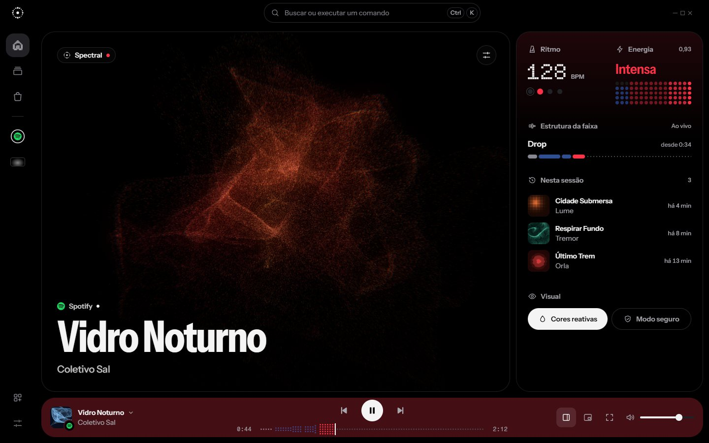
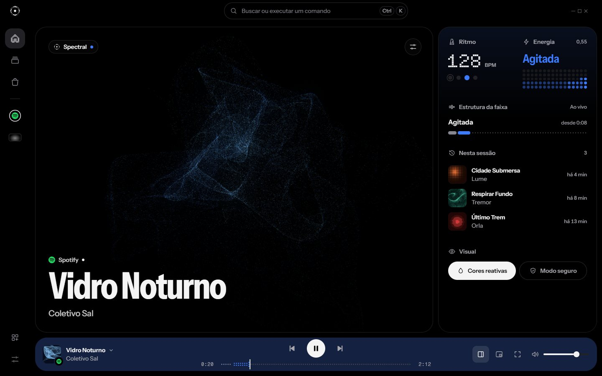
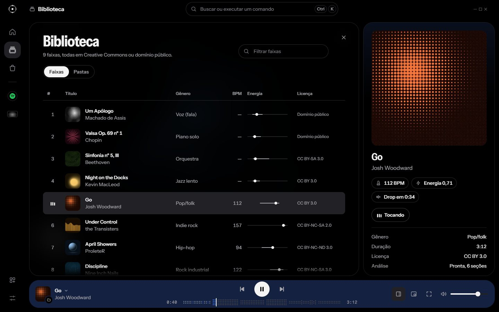
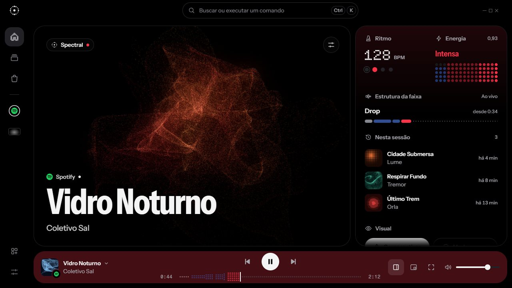
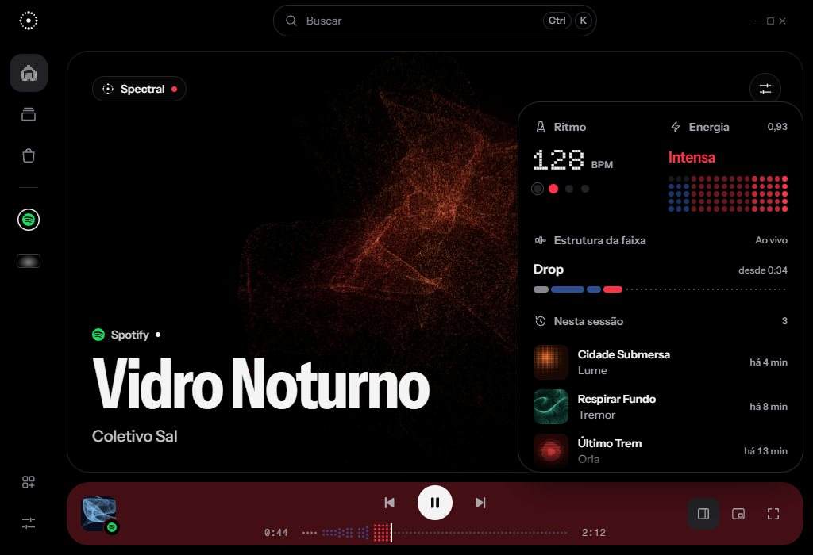
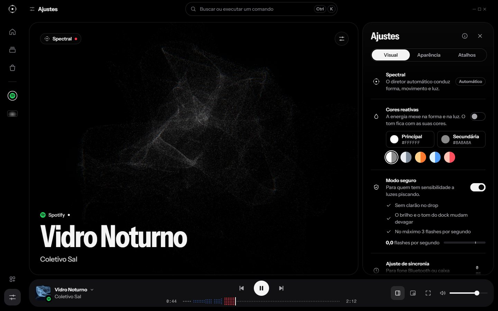
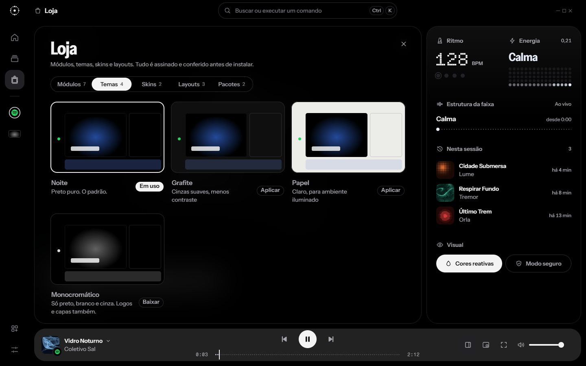
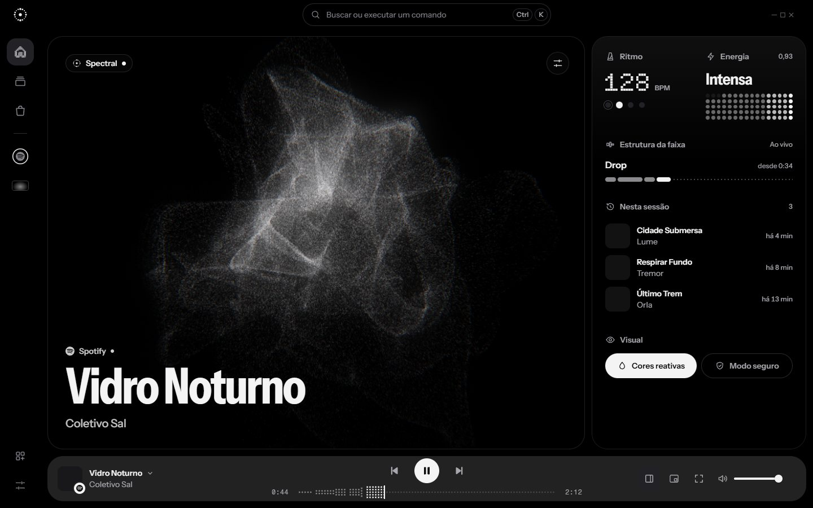
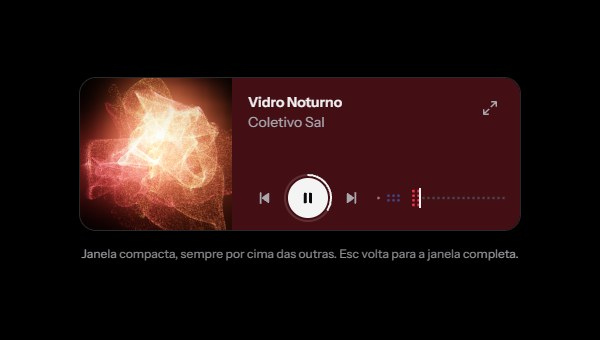

# Design da UI da v1: tema Noite (mockup v4)

Mockup da tela padrão do Player, feito antes de codar a Fase 1 do [plano da v1](plano-v1.md). A v1 do mockup
(08/11/2026, manhã) foi refeita no mesmo dia a partir da crítica: "cara de IA", sem ícones, sem identidade, fontes
pequenas e repetitivas, card dentro de card, grid comum e elementos encostados nas bordas. A v3 trouxe cor de
acento para o tema padrão, e o visual todo em cinza virou o tema **Monocromático**, baixado na Loja. A v4 aplica o
[repertório de UI](repertorio-ui.md): as medidas do redesign do Figma, as correções A1 a A16 da auditoria e as 14
micro-interações.

**Mockup interativo:** https://claude.ai/artifact/BL3KK2BQtkkwn1JfWAjXz5 (privado; compartilhar pelo menu Share).
São 15 pranchas: o protótipo interativo, nove estados, o mini player, três tamanhos de janela e o sistema visual.
Capturas em [`img/mockup-v4/`](img/mockup-v4/).



## 0. Regra de cor

O tema padrão continua **majoritariamente preto, branco e cinza**. A cor só aparece onde carrega significado:

| Onde | Cor |
| --- | --- |
| Energia da música (palavra do estado, pontos do módulo, batida, mapa, estrutura da faixa) | Calma `#E9EEFB`, agitada `#3D7BFF`, intensa `#FF3348` |
| Dock | O tom do visual, dessaturado, até luminância 0,016. Fica neutro e parado no modo seguro e com as cores reativas desligadas |
| Marcas dos serviços | Spotify `#1ED760`, Last.fm `#D51007`, YouTube Music `#FF0033`, SoundCloud `#FF5500`, Apple Music `#FA2D48` |
| Capas | Duotone colorido (12 capas geradas) |
| Confirmação e aviso | Instalado e conectado `#30D158`; novidade na barra de ícones `#FF3348` |

Botões principais, superfícies, texto e ícones continuam neutros. O tema **Monocromático** transforma os acentos,
o visual e o dock em cinza e deixa logos e capas em preto e branco.



---

## 1. O que mudou

**Da v1 para a v2:** saíram os rótulos em caixa alta e o card dentro de card; entraram o conjunto próprio de ícones,
o símbolo, os números em matriz e o mapa de energia.

**Da v3 para a v4:**

| Antes | Na v4 |
| --- | --- |
| Tudo era bloco cinza sobre preto | Moldura e painel no mesmo preto, separados por filete `#1F1F22`. Preenchimento só em estado: hover `#18181B`, seleção `#222226` |
| Módulos em caixas, num bento de alturas fixas | Módulos separados por espaço e título. A caixa só aparece no modo edição. Em 1280×720 a lista tem altura própria e o painel rola com borda esmaecida (A1) |
| Abaixo de 1060 px os módulos sumiam | O painel vira gaveta, aberta pelo botão do dock (A2) |
| A faixa sumia quando uma página cobria o palco | O dock mostra capa, título e artista, inclusive no celular (A3) |
| Biblioteca cortava a coluna Licença | Colunas com prioridade; Licença e fonte vão para o detalhe da faixa no painel (A4) |
| Ícones fora do centro no modal do Last.fm | Classes próprias para a linha e ícone sem caixa (A5) |
| Ajustes flutuava sobre o título | Ajustes ocupa o painel, e o visual continua à vista (A6) |
| 11 tamanhos de fonte e 10 raios | 7 tamanhos e 5 raios (A12 e A13) |
| 19 textos com ponto do meio | Nenhum. Estado virou ícone; autor e fonte ficam em linhas separadas (A15) |
| Relógio como módulo padrão | Módulo opcional da Loja; no lugar entrou Estrutura da faixa (A16) |

As demais correções (A7 a A11 e A14) estão na seção 7 do repertório e no mockup.

## 2. Identidade

- **Símbolo:** anel de 16 pontos de tamanhos diferentes em volta de um ponto central. Pulsa uma vez por compasso,
  nunca a cada batida, e para no modo seguro.
- **Ícone ativo em pontos:** o traço do ícone rasterizado numa grade de 12 por 12. É a mesma linguagem dos números.
- **Números em matriz:** BPM, relógio, contagens e o selo raro em **Doto**. Os dígitos rolam quando o valor muda.
- **Mapa de energia:** a barra de tempo é feita de colunas de pontos. Um vão separa as seções; a seção atual se
  acende inteira e as anteriores ficam a 50%. No Modo Escuta o mapa se desenha enquanto toca.
- **Títulos condensados:** o nome da faixa em Instrument Sans 700 com 78% de largura, grande sobre o visual.
- **Silhueta por tipo:** faixa em quadrado, pasta com aba lateral, skin em 16:9, perfil e serviço em círculo com a
  marca, pacote com abas empilhadas.
- **Selo raro:** anel de pontos com o número em Doto, só para marcos em Estatísticas.

## 3. Estrutura da tela

```
┌──────┬───────────────────────────────────────────────┬───────────────┐
│  ◎   │              [ Buscar …           Ctrl K ]                ─ □ ✕ │
│      │ ╭───────────────────────────────╮ ╭──────────────────────────╮ │
│  ⌂   │ │ ◎ Spectral •              ⚙  │ │ Ritmo 128      Energia   │ │
│  ♫   │ │                               │ │ Estrutura da faixa ▬▬▬·· │ │
│  ⬡   │ │        palco (o visual)       │ │ Nesta sessão             │ │
│ ──── │ │                               │ │ Visual: Cores, Seguro    │ │
│  ●   │ │ Spotify •                     │ │                          │ │
│  ▭   │ │ Vidro Noturno                 │ │                          │ │
│      │ ╰───────────────────────────────╯ ╰──────────────────────────╯ │
│  ▦ ☰ │ [capa] Vidro Noturno     ⏮  ⏯  ⏭  0:44 ⋯⋯▮⋯⋯ 2:12   ▣ ⧉ ⤢ 🔊 │
└──────┴─────────────────────────────────────────────────────────────────┘
```

- **Barra de ícones:** direto no preto, do topo ao rodapé. Início, Biblioteca, Loja e Estatísticas (depois do
  Last.fm); um filete; os fixados (perfil do Spotify em círculo, skin Imersiva em 16:9); Editar layout e Ajustes.
- **Palco:** o próprio visual, com raio 28 e filete. As páginas (Biblioteca, Loja, Estatísticas) nascem do ícone e
  cobrem só o palco.
- **Painel:** mesmo preto, com um degradê fraco do tom do visual no topo. Troca de conteúdo: módulos, Ajustes ou o
  detalhe da faixa na Biblioteca. Acima de 1060 px, abrir o painel encolhe o palco; abaixo, vira gaveta; abaixo de
  760 px, tudo empilha.
- **Dock:** só sob palco e painel. Capa com a marca da fonte, título e artista à esquerda; transporte e mapa no eixo
  da janela; painel, mini player, tela cheia e volume à direita. No celular ele gruda embaixo com título e controles.
- **Mini player:** janela compacta de 440×152 com o visual ao lado, anel de progresso no play e o mapa.







## 4. Referências usadas

| Fonte | O que entrou |
| --- | --- |
| Redesign do Spotify no Figma (Juxtopposed), com o CSS das 16 telas | Duas camadas no mesmo preto, filete como contêiner, dock na cor da capa, silhueta por tipo, ações da linha no hover, letra em karaokê como modelo do mapa |
| Pasta do Pinterest (17 referências) | Títulos enormes sobre imagem, barra de ícones à esquerda, player centralizado com play redondo |
| [Impeccable](https://github.com/pbakaus/impeccable) (Paul Bakaus) | Piso de qualidade: sem rótulo acima de título, sem card dentro de card, contraste mínimo, mono só para dados, vidro só com função |
| [Emil Kowalski](https://github.com/emilkowalski/skill) | Movimento: saída forte, pressionar 120 ms, menus 200 ms, painéis 240 ms, saída mais rápida que a entrada, molas interrompíveis |
| React Bits, 21st.dev e CodePen | Volume elástico, números que rolam, segurar para confirmar, aviso arrastável, marcador que desliza |
| Hyprland e end4 | Modo edição com grade de pontos, layout por tamanho de janela |
| Simple Icons (CC0) | Desenho e cor de marca dos logos |

## 5. Tokens (tema Noite)

| Token | Valor | Uso |
| --- | --- | --- |
| `wall` | `#000000` | Moldura e painel |
| `hair` | `#1F1F22` | Filete dos contêineres (1,3:1) |
| `tile-2` | `#111113` | Menus, modais e paleta |
| `hover` | `#18181B` | Hover |
| `sel` | `#222226` | Seleção e item ativo |
| `fg` | `#F2F2F3` | Texto (18,8:1) |
| `fg-2` | `#A7A7AD` | Apoio (8,8:1); o mínimo no dock e na seleção |
| `fg-3` | `#808087` | Discreto (5,4:1); fora do dock e da seleção, onde cai para 4,0:1 |
| `fg-4` | `#46464C` | Só desabilitado e decoração (2,2:1) |
| `inv` | `#F4F4F5` | Botão principal (texto `#0B0B0C`) |
| `tone` | calculado | Cor do visual dessaturada 30%, até luminância 0,016; o apoio fica em 6,6:1 sobre ele |

O estado de energia atual vira uma classe na raiz (`en-0`, `en-1`, `en-2`), que troca o token `en`. Os temas
**Grafite** e **Papel** usam os mesmos nomes; no Papel os acentos são mais escuros. As cores reativas do visual são as
da prévia: calma `#FFFFFF` e `#DEE6FF`, agitada `#2E6BFF` e `#8FE3FF`, intensa `#FF1A38` e `#FF8C38`.

**Tipografia:** Instrument Sans (interface, de 78% a 100% de largura), Doto (números) e Fragment Mono (tempo e
código), todas com licença OFL. Escala de 7: 12/16, 14/20, 16/24, 20/28, 28/32, 44/44 e 88/80.

**Forma:** raios 28 (palco, painel, dock e folhas), 16 (capas, cartões e menus), 10 (controles), pílula e círculo.
Espaço de 12 px entre as peças da moldura e base 4 no resto.

**Movimento:** pressionar 120 ms e voltar em 160 ms; menus 200 ms; painéis 240 ms; gaveta 300 ms; troca de faixa
260 ms com o artista 40 ms depois. Nada anima em atalho de teclado, e tudo respeita o movimento reduzido.









## 6. Notas para implementar no GPUI

- **Superfícies:** o painel e a moldura são o mesmo preto; o filete é uma borda de 1 px. Não há vidro fora do
  visual. Nas páginas sobre o palco, o desfoque vem da camada do visual (`janela/`, DirectComposition), que desenha
  uma cópia desfocada só nessa área.
- **Tom do dock:** calculado a cada quadro a partir da cor do visual, com média de 2 s (6 s no modo seguro, já
  neutro). A conta de luminância é a mesma do teste de contraste da WCAG.
- **Cabeçalho fixo das páginas:** o desfoque por elemento não é garantido no GPUI 0.2. O plano B é faixa opaca com
  a borda de baixo esmaecida, como no mockup.
- **Painel em gaveta:** o mesmo nó do layout em árvore, posicionado por cima abaixo de 1060 px.
- **Ícone ativo em pontos:** rasterizar os ícones na compilação, não em tempo de execução.
- **Mini player:** janela própria sempre por cima, com a mesma camada do visual numa área de 152×152.
- **Mapa e estrutura:** com arquivo local, as seções vêm da pré-análise; no Modo Escuta, aparecem conforme a faixa
  toca.
- **Capas:** no Modo Escuta a capa vem do Windows (SMTC). Para arquivos sem capa, o app pode gerar uma no estilo das
  capas do mockup.
- **Logos de serviços:** conferir as regras de marca de cada serviço antes de usar os logos no app de verdade.
- **Acessibilidade:** o GPUI 0.2 ainda não fala com leitor de tela. Foco visível, alvos de 24 px e navegação por
  teclado ficam por nossa conta.
